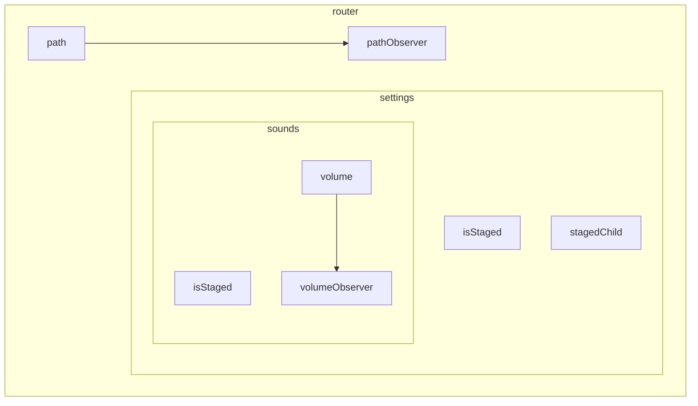

<!--
@license
Copyright (c) ggsuite

Use of this source code is governed by terms that can be
found in the LICENSE file in the root of this package.
-->

# Keep the route state on the supply chain

## Motivation

- Up to 3.x `gg_router` kept its state in a tree of `GgRouteTreeNode`s with
  `GgValue` parameters. Only code with a `BuildContext` or a reference to
  that tree could navigate or observe the navigation.
- Apps that keep their state on `supply_chain` want the route state there
  too: visible in the scope graph, readable and writable as nodes, without
  a second state mechanism.
- 4.0.0 moves the route state onto the supply chain and keeps the widget
  API and the saved JSON of 3.x.

## Strategy

- One scope per route, the root route owns the scope `router`.
- Input nodes for everything the navigation writes: `path`, `isStaged`,
  `stagedChild` and one node per parameter.
- Observer nodes for writes from outside: writing `router/path` navigates,
  writing a parameter node informs the URI.
- Keep the navigation logic and the widgets, swap only the storage.
- Keep the JSON format of 3.x, so saved route states load unchanged.

## The scope `router`

- `GgRouteNode.newRoot(scope: appScope)` creates `router` in the scope of
  the app; without a scope it creates a supply chain of its own.
- Route names that are not lower camel case get encoded keys:
  `_INDEX_` becomes `§index`, `*` becomes `§any`.
- All router nodes produce with the priority `realtime`, so navigation
  needs no frame tick.
- The golden `test/goldens/gg_route_node/router.mmd` shows the whole graph.

## Parameters

- `GgParam` replaces `GgValue`: `value`, `stringValue` and `stream` work as
  before, `node` is the input node.
- Untyped parameters, e.g. from `GgRouteParams`, take the type of their
  seed, as supply chain nodes need a concrete type.

## Widgets

- `GgRouter`, the delegate, navigation pages, popovers and animations keep
  their API and listen to the change streams of `GgRouteNode`.
- `GgRouter.of(context)` offers `scope` and `pathNode`.
- New: `GgRoutePathBuilder` rebuilds with the staged path through a
  `NodeBuilder`; it needs a `ScmTickDriver`.

## Migration

- Rename `GgRouteTreeNode` to `GgRouteNode`, use `GgParam` instead of
  `GgValue`, drop `gg_value` and `gg_once_per_cycle`.
- The README section "Migrate from 3.x" lists all steps.

## Open Points

- `isStaged` is an input written by the navigation, not derived from
  `path`, because the widgets need the staging synchronously.
- The built-in widgets could move to `NodeBuilder` once every app mounts a
  `ScmTickDriver`.
